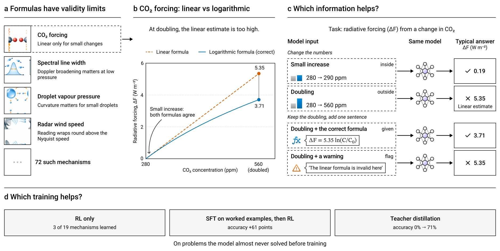
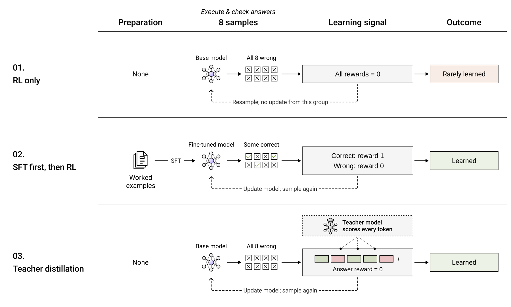
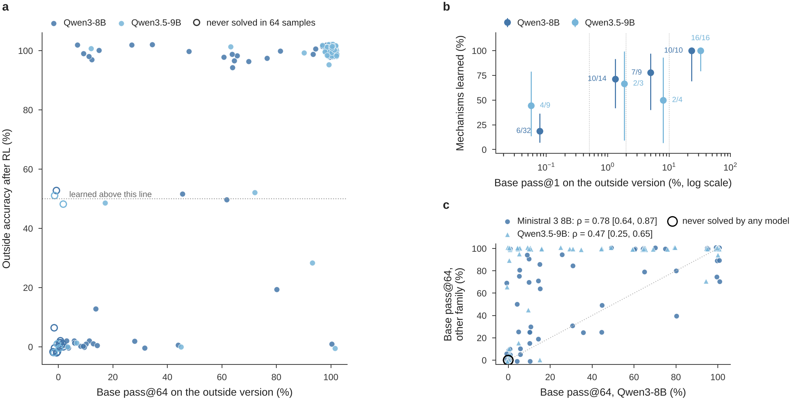
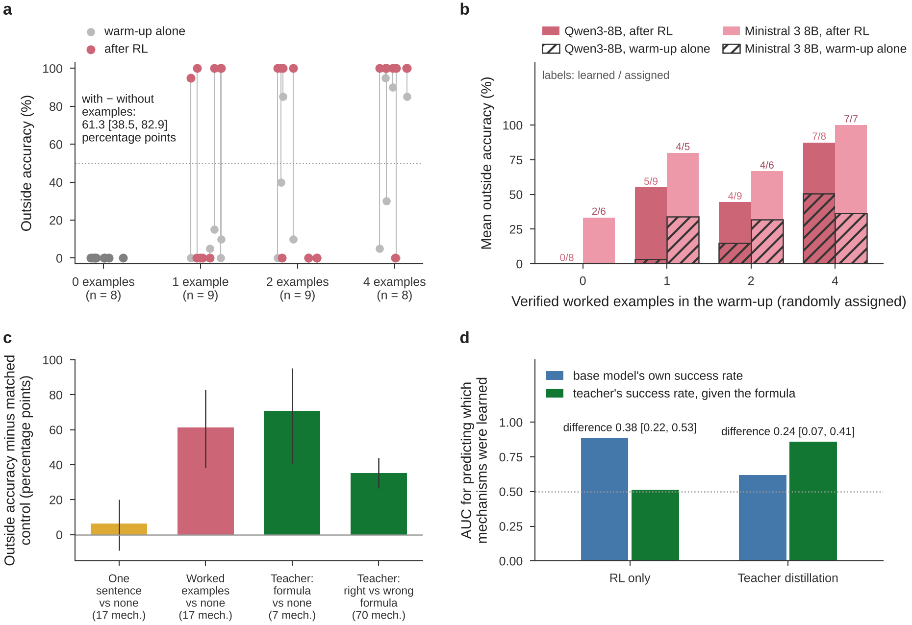

# AtmosRegime

Code, data and results for

**Language models misapply atmospheric formulas until trained on a few worked examples**
Maohao Ran, Yanting Zhang, Chendong Ma and Jun Song

The radiative forcing from a doubling of CO₂ is about 3.7 W m⁻². Extrapolating the rate for a small change
linearly gives 5.35, which is 44% too high. We put this problem to three open language models 64 times each,
and none of them ever produced the logarithmic answer. The wrong answer comes from a program that runs and has
the right units, so nothing flags it.

Large language models are increasingly employed for scientific computation in atmospheric and environmental
research. Many such calculations depend on specific physical regimes, beyond which the conventional formulas no
longer apply. Models often fail to adapt to these limits and return plausible but inaccurate results. This
repository holds the controlled experiments with which we studied these failures and asked whether targeted
training can repair them.



*Fig. 1 of the manuscript. **a**, four of the 72 mechanisms. **b**, the CO₂ forcing law. **c**, the same model
asked the CO₂ problem in four versions; the answers show the typical pattern, not measured rates. **d**, results
of three training routes on mechanisms the base model rarely or never solves.*

## Main results

| Result | Value | Figure | Result file |
|---|---|---|---|
| Accuracy lost beyond the regime, 16 open-model configurations | 13 to 57 points | 2a | `results/paper/d_reword.json` |
| Recovered by a warning that the formula fails | 0.7 to 8.4 points | 2a | `results/paper/d_reword.json` |
| Recovered by stating the correct formula | most of the loss | 2a | `results/paper/d_reword.json` |
| Trained Qwen3.5-9B against DeepSeek V4 Flash (284B) on benchmark regime problems, both without thinking | 54.9% against 56.5% | 6c,d | `results/paper/frontier21.json` |
| Never-solved mechanisms learned by reinforcement learning alone | 3 of 19 | 7a | `results/x/report_qwen3-8b.json`, `results/x/report_qwen35-9b_s42-43.json` |
| A few worked examples, then the same reinforcement learning | +61 points | 8a,b | `results/dose/report_qwen3-8b.json` |
| A teacher model given the correct formula | 0% to 71% | 8c | `results/opd/report_qwen3-8b_seeds42-43.json` |

Figure numbers are those of the manuscript.

## The diagnosis

Each of the 72 templates poses one problem in four versions that differ by a single sentence: inside the regime,
outside it, outside with the correct formula stated, and outside with only a warning that the standard formula
fails. Comparing the four separates a model that does not notice the regime from one that lacks the formula.

Open and frontier models misapply standard formulas beyond their regime. The loss appears in all five model
families, with thinking on or off, and the same mechanisms fail in most models. Stating the correct formula
recovers most of it. A warning alone recovers little, and models that judge the formula invalid often apply it
anyway. What the models lack is the formula.

## The training



Reinforcement learning with verifiable rewards lets a 9B model match a 284B one on benchmark regime problems,
but it rarely teaches a formula the base model almost never produces. Ten times more training on eight
unlearned mechanisms learned none of them.



*Base pass@64 against accuracy after reinforcement learning, per mechanism (a), and the share of mechanisms
learned by how often the base model solved them (b).*

Supervised fine-tuning on a few worked examples, followed by the same reinforcement learning, repairs such
mechanisms. The examples were assigned at random, and most of the rise comes from the reinforcement learning
that follows the fine-tuning. Distillation from a teacher model given the correct formula repairs them too.



*Outside accuracy by the randomly assigned number of worked examples (a, b); the effect of four ways of
supplying the formula against matched controls (c); whose starting accuracy predicts what each method learns (d).*

Every confirmatory analysis was pre-registered with its decision rule. The pre-registrations and their dated
amendments are in `docs/`.

## Repository

```
atmoscoder_rl/     templates, evaluation, execution and grading, rewards, splits, statistics
  templates/       one module per regime mechanism (MECHANISMS.md lists them)
  engine.py        execution and grading core of AtmosCoder-Bench, included unchanged
  grading.py       unit rules, including the stricter rule used for the training reward
  sandbox.py       isolated execution of model programs
data/              benchmark problems and traps (data/README.md, data/DATASET_CARD.md, data/PROVENANCE.md)
splits/            the frozen train/test partition (splits/MANIFEST.md)
explore/           builders, launchers and report scripts for every experiment
train/             training configurations (reinforcement learning, fine-tuning, distillation)
results/           every result file behind the numbers and figures of the manuscript (results/README.md)
paper/fig/         scripts that regenerate the numbers, tables and figures from results/
docs/              pre-registrations (PREREG_*.md), the timeline of dated records, template design,
                   measurement notes and the design of the counterfactual reward
models.toml        model configurations for evaluation; holds no keys
```

The pre-registration documents are written in Chinese. Some files refer to internal planning documents that are
not part of this release.

## Setup

```bash
uv sync                     # the package; the reward path uses the standard library only
uv sync --extra eval        # OpenAI-compatible client for model calls
uv sync --extra paper       # matplotlib and numpy for the figure scripts
```

Python 3.11 or later. Training also needs verl (commit 5b79827b), vLLM 0.24, torch 2.11 and transformers 5.9
on GPU hosts.

## Checks

These modules assert and report; they are the test suite.

```bash
uv run python -m atmoscoder_rl.check_corpus              # corpus composition and invariants
uv run python -m atmoscoder_rl.check_solvers --set all   # every stored solver reproduces its answer
uv run python -m atmoscoder_rl.check_templates           # every template: physics, texts, grading
uv run python -m atmoscoder_rl.build_splits --check      # the frozen partition is intact
uv run python -m atmoscoder_rl.check_reward              # the reward, including sandbox isolation
```

Do not run `build_splits --force`. Every result is conditioned on the current partition.

## Reproducing the numbers and figures

The scripts in `paper/fig/` read only files under `results/`, so this step needs no GPU.

```bash
uv run --extra paper python paper/fig/make_numbers.py > numbers.tex   # every number quoted in the text
uv run --extra paper python paper/fig/fig2.py                         # one script per figure, written to paper/figures/
```

## Running the experiments

Evaluate a model on a problem file. The model is a section of `models.toml`; a local model is served with vLLM
first.

```bash
uv run --extra eval python -m atmoscoder_rl.evaluation.runner --model <models.toml section> --input <problems.json> --exp-id <id>
```

Train. These scripts were written for our cluster; its paths, host names and model endpoints are replaced by
placeholders, so set them for your own environment first.

```bash
EXP=<run name> bash train/dapo_qwen3_8b.sh                    # reinforcement learning with verifiable rewards (DAPO in verl)
NAME=qwen3-8b MODEL=<path> SEEDS="42 43" bash explore/x_chain.sh  # the template study: warm-up and five reward variants, both folds
ARM=P FOLD=F1 SEED=42 GPUS=0,1,2,3,7 bash train/opd/run_opd.sh    # on-policy distillation from a teacher given the formula
```

`SMOKE=1` runs two steps of any of them as a pipeline check. Each experiment's builders, launchers and report
scripts are in `explore/`, and its rules are in the matching `docs/PREREG_*.md`.

Compute. One reinforcement-learning run uses eight H800 GPUs for 2 to 24 hours (120 steps, or a 24-hour cap);
a distillation run uses five GPUs for 3 to 4 hours. The 68 runs behind the manuscript took 5,752 GPU hours.

## Not included

Raw model outputs and training checkpoints are large and are available from the corresponding author on
reasonable request. File hashes quoted in the pre-registrations refer to the original files, before the
placeholders were put in.

## Grading

Each answer is graded by running the model's program and comparing every sub-answer with a certified value at
5% relative tolerance. The training reward uses a stricter unit rule: the benchmark's rule converts °C to K
before a relative comparison, which widens the tolerance on answers given in Celsius. Pass `units="benchmark"`
to grade under the published rule.

## Licence

Code is released under the MIT License (`LICENSE`). The data in `data/`, `splits/` and `results/` are released
under CC BY 4.0 (`LICENSE-DATA`).

## Citation

The manuscript is under review.

```bibtex
@unpublished{ran2026regime,
  title  = {Language models misapply atmospheric formulas until trained on a few worked examples},
  author = {Ran, Maohao and Zhang, Yanting and Ma, Chendong and Song, Jun},
  year   = {2026},
  note   = {Manuscript under review}
}
```
